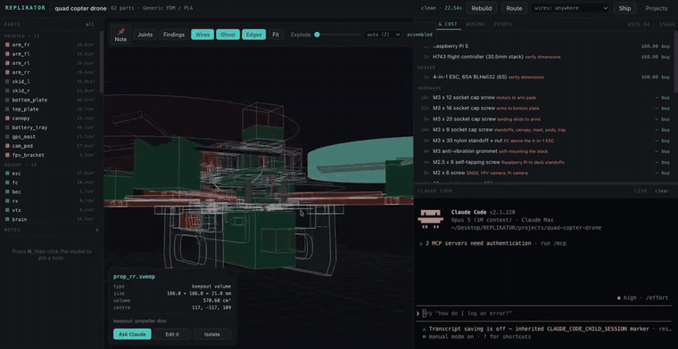
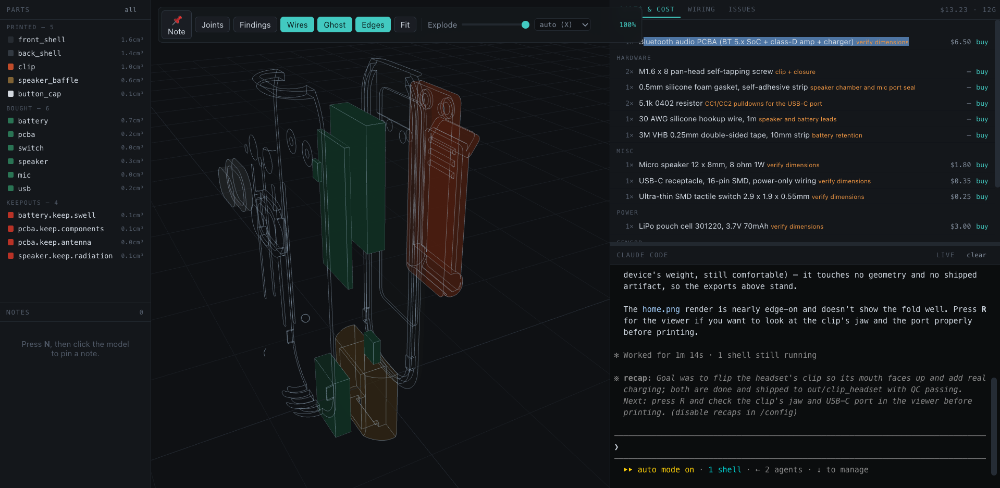

> **This is the public home for HEPH-3D.** The source is private — what you'll find
> here is the demo, the full documentation, and how to get a build.
> The app lives at **[heph3d.com](https://heph3d.com)**.

**Machines, not models.** Describe one; get printable, validated files for a
machine that works when you assemble it.

[](https://heph3d.com/#access)
[](#the-studio)
[](https://github.com/gumyr/build123d)
[](#tests)
[](LICENSE)



<sub>[Full demo (39s, no sound)](docs/media/demo.mp4)</sub>

Describe a thing; get a folder of validated files you can print, a costed list
of parts you can buy, and a machine that works when you assemble it.

Not a single static shape. A machine, in parts, with real mechanisms, real
electronics mounted at their true hole patterns, wiring, clearances tuned to your
printer and material, and every joint swept for collisions before anything is
written to disk.

```
FORM -> PLAN -> LAYOUT -> ENCLOSE -> ROUTE -> VALIDATE -> SHIP -> QC
```

One command runs all of it:

```bash
./run.sh make "a robot that drives around, sees with a camera, \
               avoids obstacles and shows status on a screen" \
          --name scout --envelope 190x180x150
```

From that sentence: **10 components chosen and sourced**,
a solved internal layout, a lofted enclosure sized to what is inside it with
**connector openings cut from the components' own keepouts**, a routed harness
with **73% of its wire bundled into shared trunks**, printed cable clips, full
validation, and a shipped bundle — **$110, 606g, 21 files, QC PASS**.

## The Studio

**[Get the app](https://heph3d.com/#access)** and drag it to Applications. It
carries its own Python and CAD kernel — no install, no dependencies, nothing to
set up. Your machines are saved to `~/Documents/HEPH-3D`.

The source for HEPH-3D is private; this repository is its public home — the
demo, the documentation, and how to get access. Builds are handed out by tester
code at [heph3d.com](https://heph3d.com/#access).

**It updates itself.** *Tools ▾ → Check for updates* downloads the new build,
checks the version inside it really is the one it claims, installs it over the
running copy and reopens — on macOS, Windows and Linux. The code you first
entered is remembered, so the site is only needed once.

**Claude, either way.** The terminal pane runs Claude Code in the Studio itself.
Or hand the project to **Claude Desktop** — it opens a new **Code** session with
the folder already selected and brings the 3D view up beside the chat. With both
installed the Studio asks which you want; with one, it just uses it.

> **macOS 11+, Apple Silicon and Intel.** The app is signed but not
> *notarised*, so macOS says it *"could not verify HEPH-3D is free of malware"*
> and offers only *Move to Trash*. Nothing is wrong with the build. Drag it to
> Applications, then run this once:
>
> ```
> xattr -dr com.apple.quarantine /Applications/HEPH-3D.app
> ```
>
> On macOS 15 and later, right-click → **Open** no longer works — Apple removed
> it. Requires [Claude Code](https://claude.com/claude-code) installed and
> signed in; HEPH-3D runs your own copy under your own account.

Or run it from a checkout — `HEPH-3D.command`, double-clicked, starts the
Studio and opens a browser. Or from a shell:

```bash
./run.sh studio            # http://127.0.0.1:8810
```



A 3D workspace with **Claude Code anchored inside it** — not a chat widget
talking to an API, but a real `claude` process on a pty, running in the project
directory. Click a part and press *Ask Claude* and it types real context into
that session. Press `N` and click the model to pin a 3D note with coordinates.
Drag the joint sliders to pose the mechanism.

Edit `design.py` — by hand or by asking Claude — and the model rebuilds and
reloads on its own; the view never trails the file. The session is yours: it
survives a reload, and reopening a project resumes the conversation you left.

| | |
|---|---|
| `X` | explode the assembly and put it back |
| `E` | draw every part's hard edges |
| `G` | ghost the shells to see what is inside them |
| `W` | show the routed harness |
| `J` | pose the mechanism |
| `N` | pin a note in 3D |
| `R` | rebuild |
| `F` | frame everything |

**Exploded view.** The slider takes the machine apart along the axis it
actually comes apart on, worked out from how flat its parts are rather than
from where their centres sit — a clamshell parts sideways even when it is long
in another direction. A relaxation pass then guarantees no two parts overlap at
full travel, so the inside can genuinely be inspected. Or choose the axis
yourself, or send everything out spherically.

**Wire routing** can be constrained: hidden inside the machine, visible outside
it where you can service it, or *best* — concealed wherever concealment is
possible, surfacing only where the alternative is not routing the net at all.

**The design says where the loom goes.** Cut a bore up a mast or a grommet
through a wall and declare it, and the harness routes through it rather than
finding its own way around:

```python
asm.cableway("mast_bore", Cylinder(radius=3, height=60).moved(at),
             note="camera leads run up inside the mast")
asm.wire("SERVO_SIG", (80, 0, 92), (80, 0, 60))   # waypoints, in order
```

A declared route is an instruction, not a hint: it is carved into the free
space the router searches, so a bore too narrow to survive rasterisation still
gets used. Anything a component declares for its own leads — a GPIO header, a
ribbon path — is a corridor for that component's nets automatically. And a
channel counts as restraint: no clip is fitted inside a bore that already
carries the wire.

In Claude Code, type `/heph` to pick a project and open it.

## Why this exists

Plenty of tools turn text into a mesh. They model a *part* -- a bracket, an
enclosure, a phone stand. A machine is a different problem: several bodies that
must not collide *anywhere in their range of motion*, that must each survive
being printed alone, and that a human then has to assemble.

Nothing free did that. The pieces existed -- build123d is an excellent solid
kernel, and `build123d-mcp` wraps it well (though its published package fails to
import) -- but the assembly, mechanism and kinematic-validation layer did not.
That layer is what this is.

## Quick start

Describe the machine and let it build one:

```bash
./run.sh make "a desk clock with a flip display and a rotary knob" \
          --name clock --envelope 140x90x110
```

Or start a project and open it in the Studio:

```bash
./run.sh new "My Machine"      # scaffolds ~/Documents/HEPH-3D/my-machine
./run.sh studio my-machine
```

Or install it and use the CLI against a design file directly:

```bash
uv pip install -e .
heph build  ~/Documents/HEPH-3D/my-machine/design.py
heph ship   ~/Documents/HEPH-3D/my-machine/design.py -o out/mine
heph profiles
heph fits --printer x1c --material petg
```

A design is an ordinary Python module exposing `build() -> Assembly`. Keeping
the entry point that plain means it is a script you can run, import, diff and
test, rather than a proprietary document.

**Your machines are yours.** They are saved to `~/Documents/HEPH-3D`, never
inside this repository and never inside the app bundle. Nothing you design is
part of the tool.

## What gets validated

| Check | Catches |
|---|---|
| swept interference | bodies that collide part-way through a joint's travel |
| static interference | overlaps at rest |
| clearance audit | declared fits that are tighter than their fit class allows |
| tolerance grade | fits finer than the process can actually hold |
| wall thickness | walls thinner than an extrusion, via inward ray casting |
| overhang | unsupported ceilings, judged in the print orientation |
| connectivity | parts that are secretly several disconnected bodies |
| enclosed voids | sealed cavities (an error on resin -- no drain) |
| manifold | non-watertight meshes a slicer would misread |
| bed fit | parts too big, including "fits only if rotated 90 degrees" |
| keepouts | a wall fouling a USB plug, a camera looking into a bracket |
| power budget | peak draw exceeding the supply; a rail with no regulator |
| motor stall | a supply that copes running and collapses at locked rotor |
| voltage drop | a rail that arrives brown-out low after a long thin run |
| connectors | current through a connector rated below the wire feeding it |
| QC | stale exports, missing STLs, unverified dimensions, docs naming parts that no longer exist |

## Electrical honesty

A netlist that only says what connects to what will pass a design that browns
out. Five things are checked that a schematic cannot know on its own:

**Stall, not running peak.** A motor draws three to four times its running
current when the shaft cannot turn, which happens on every start-up and every
time the machine hits something. Sizing on running peak passes every check and
fails the robot. Motors are fed from the pack rather than the logic rail, so a
stall cannot pull the brain's supply down with it, and the budget is reported
per rail:

```
pack   8.00 A limit   1.20 A peak   3.20 A stalled   +4.80 A spare
5v     5.00 A limit   5.30 A peak                    -0.30 A
```

**Voltage drop**, once the harness has a physical path — the one electrical
quantity that needs the geometry. The loop is the supply conductor *and* the
return; counting only one halves it and clears a run that does not work.

**Connector ratings.** A 20AWG pair carries 5A happily and the JST-XH on the
end of it does not. The connector is what melts, and checking only the wire
clears the joint that fails.

**Fuse sizing** off the stall figure at 1.5×, so it survives inrush rather than
blowing at switch-on and teaching you to fit a bigger one.

**A way to put the charge back.** A machine that stores energy and has nothing
that can refill it — no charger, no socket, no panel — fails inspection rather
than being discovered flat on the second day. Cells you take out to charge are a
legitimate answer; it just has to be a decision, written down, not an omission.

## Honest tolerances

Machinists think in ISO 286 — H7/g6 and so on — and FDM cannot hold those
grades. The useful thing is not to pretend, but to say what the process
actually delivers and refuse a fit that needs better.

Every printer states the IT grade it holds: a well-tuned CoreXY about **IT12**,
a stock bedslinger **IT14**, resin **IT11**. Tolerance is size-dependent, so
"±0.1mm" means nothing until you say at what size — the zone comes from the ISO
standard tolerance unit and agrees with the published table to within a few
percent.

```
$ ./run.sh fits --printer ender3 --material petg
  grade      IT14 -- what this machine holds on a printed feature

  press    H7/p6 -- locational interference
    ok    3.0 mm   0.130mm interference against 0.217mm of scatter; the material yields
    NO   25.0 mm   a press fit at 25mm intends 0.130mm of interference against IT14
                   scatter of 0.523mm -- some parts will fall together and some will
                   split the boss. Pin it, screw it, or design for a snug fit and glue
```

A fit finer than the machine's own scatter is not a tight fit, it is an
unrepeatable one — the geometry checks out and the assembly is a coin toss.
Declared interfaces are checked against this, so it fails validation rather
than surprising you on the bed.

## Tolerance stackup

A fit is local: does this shaft turn in this bore. The question a professional
asks first is what six of them add up to.

```
gear_0 -> gear_1 -> gear_2 -> gear_3 -> gear_4 -> gear_5 -> gear_6
  6 link(s), worst case ±1.920mm, RSS ±0.784mm
```

Every link there is within spec, and the far end of the train is nowhere near
where it should be. `ASSEMBLY.md` reports worst case and RSS together —
reporting one without the other invites the wrong decision in both directions —
along with the link count, because RSS over a two-link chain is a statistical
claim about a sample of two. It also names the single worst contributor, since
that is where effort pays.

Each link contributes the larger of the fit's own play and what the printer's
grade holds at that size: a feature cannot be more accurate than the machine
that made it, however tightly the fit is drawn.

## Inspecting the print

QC says the design is sound. Only calipers say the print came out — and they
need to know which of a part's several hundred dimensions matter. The system
already knows: `PROFILE.bore(3.0, Fit.FREE)` says in the design's own source
that this hole exists to pass an M3 screw freely. That meaning used to be
discarded the moment the call returned a float.

```bash
./run.sh inspect projects/my-machine/design.py arm_fr -o INSPECTION.md
```

| Measure | Nominal | Accept | Why | Declared at |
|---|---|---|---|---|
| Ø3.86 hole at (17.68, 17.68) | 3.86 mm | 3.66 – 3.96 | must accept a 3mm shaft as a free fit | `design.py:176` |
| overall length | 114.58 mm | 114.35 – 114.81 | catches a mis-scaled or badly shrunk print | - |

Every cylindrical face is pulled from the solid — axis, diameter, depth, hole
or boss — and matched against the recorded `bore()` calls. Positions are given
from the part's own corner, because world coordinates for an arm rotated out to
45° are perfectly true and no help to someone holding it.

The accept band is not an invented tolerance. It comes from the profile's own
fit ladder: a hole cut for a running fit is out of band once it has tightened
to a snug fit or opened to a free one. Both ends are real failures with names,
and the band moves correctly when you calibrate, change material or change
nozzle. `INSPECTION.md` ships in every bundle.

## Profiles

Every clearance in every design flows through one profile object, so retargeting
a whole machine to another printer or material is a one-line change:

```python
PROFILE = Profile.get("x1c", "petg")
BORE = PROFILE.bore(6.0, Fit.RUNNING)
```

Nine printers, eight materials. Ooze/swell, thermal shrinkage and hole
undersizing are corrected automatically -- a nominal 5mm hole prints at about
4.8mm, and the profile compensates so you do not have to remember.

### Calibrate it to your machine

Those corrections are estimates until you measure. One coupon fixes that:

```bash
./run.sh calibrate --printer x1c --material petg -o out/cal
#   print coupon.stl, measure six things, fill in measurements.json
./run.sh calibrate --printer x1c --material petg --sheet out/cal/measurements.json
```

The coupon carries bores and pegs at **exact nominal** — holes print small and
pegs print large from the same bead width, and measuring both separates two
effects that a single "tolerance" number cannot. Plus the plate's own span for
shrinkage, a post measured at the base and above it for first-layer squish, a
ladder of thin fins for the minimum wall, and four pin-and-socket pairs cut
through your current profile as the sanity check — if the socket marked
*running* does not turn, something upstream is wrong.

It reports what changed and what that does to a real fit, not just a table of
deltas:

| Fit | 6mm bore before | after | change |
|---|---|---|---|
| press | 6.020 mm | 6.032 mm | +0.012 mm |
| running | 6.750 mm | 6.702 mm | -0.048 mm |

Then `PROFILE = calibrated("x1c", "petg")` in a design and every bore, shaft and
wall moves together. Opt-in on purpose: a profile that silently read a file from
your home directory would mean the same design produced different geometry on
two machines with no sign of why — the exact class of bug this tool exists to
catch.

## Electronics

23 components with real dimensions, hole patterns, keepouts, mass, current draw
and a price. Mount one and the standoffs are generated at its true pitch:

```python
bosses = parts.mount(asm, "pi5", "brain", Location((0, 0, DECK_Z)),
                     boss_height=7.0)
deck = deck + bosses          # four M2.5 standoffs on the real 58 x 49 pattern
```

Every entry states where its numbers came from — `datasheet`, `common` or
`nominal` — and QC lists every non-datasheet dimension the design relies on.
Correcting one is a JSON override, not a code change.

**Your own parts are kept.** Anything in `~/.heph/parts/*.json` loads for every
project *and* for the planner that chooses components — so a part measured once
can be *picked* by a later design, not merely referenced by one that already
knows its name. `$HEPH_PARTS` adds a further file or directory for a shared
library, and `heph parts` marks your entries with `*`. Add the part rather than
substituting one that nearly fits: dimensions come from a drawing or the part in
hand, and `confidence` records which.

### Verify the parts you actually bought

Knowing a dimension is unverified is only half of it. `verify` produces the
checklist:

```bash
./run.sh verify --design projects/my-machine/design.py -o out/verify
#   13 component(s), 11 not yet verified
#   measure, fill in the blanks, then:
./run.sh verify --sheet out/verify/measurements.json -o project-parts.json
```

The sheet asks for what you can actually measure. The catalogue stores hole
*positions* — `(-29.0, -24.5)` — and nobody has ever put a caliper on a board
and read off a coordinate, so it asks for the distance across the outermost
holes and rescales the pattern about its own centre. That corrects the size
while preserving the shape, which was never the part in doubt.

Each item says what breaks if it is wrong, ordered so that if you stop after
two you measured the two that matter — a hole span 1mm out means the board will
not go on its standoffs at all; a body height 1mm out means a lid sits proud.
A reading too far from nominal is refused with a note rather than accepted,
because the usual mistake is measuring the wrong feature.

Measured parts are marked `measured`, which outranks `datasheet`: a datasheet
describes the part the manufacturer meant to ship, and the one in your hand is
the part they actually shipped.

Components also get **detailed geometry**: a battery holder with its cells, a
servo with its flange and horn, a wheel with a tyre. That detail is clipped to
the catalogue envelope, so swapping a box for a modelled part can never change
an interference result.

## Export formats

STL, STEP, 3MF, BREP, glTF/GLB, OBJ, PLY, DAE, plus DXF and SVG for flat parts
you would rather laser-cut than print. `flat_parts()` finds those automatically;
2D export refuses anything that is not a plate rather than silently projecting a
bracket into a wrong cut file.

## The mechanism library

- `gears` -- true involute spur gears, ring gears, racks; they mesh because the
  flank is a real involute, not a trapezoid
- `motion` -- ratchets, pawls, detents, Geneva drives, cams, cranks, linkages,
  escapements
- `joints` -- print-in-place pivots, snap hooks, living hinges, dovetails, screw
  and heat-set bosses, keyed shafts
- `springs` -- helical, leaf and spiral springs, with the beam equations attached
- `enclosure` -- shells, panels, windows, hoppers, chutes, vents

## As a Claude Code skill

```bash
./install.sh
```

Installs `skill/` to `~/.claude/skills/heph/`. After that, asking Claude
Code to design a printable object routes through this pipeline.

## Tests

```bash
uv run --with build123d --with trimesh --with numpy --with rtree \
       --with scipy --with networkx --with matplotlib --with pytest \
       python -m pytest tests/ -q
```

257 tests. Most of them exist because the behaviour they assert was once wrong
in a way that produced a plausible-looking result instead of an error -- an
interference check that returned 0.0 for every pair, gears that did not roll, a
spring with negative volume, a wall-thickness check that failed sound parts, a
harness that reported every net routed while the wire ran through a servo.

## Layout

```
heph/
  profiles.py     printers, materials, fit classes
  assembly.py     Part, Joint, Interface, Assembly, kinematics
  validate.py     interference, sweeps, printability
  concept.py      the massing/blockout stage
  electronics.py  nets, power budget, harness routing
  sourcing.py     bill of materials and buy links
  formats.py      every export format
  qc.py           the final inspection
  session.py      projects
  ship.py         export, renders, generated documents
  mcp_server.py   the MCP bridge (no dependencies)
  cli.py
  mech/           gears, motion, joints, springs, enclosure
  parts/          component catalogue, mounting, detail geometry
studio/           the 3D workspace (FastAPI + three.js + a pty)
desktop/          the macOS app (Tauri)
site/             heph3d.com -- the public page and the tester download gate
skill/            the Claude Code skill
tests/
```

Everything lives in this one private repository, on `main`. Builds are published
as releases here; the site hands them to testers who have a code, so the repo
itself never has to be shared.

**Proprietary.** All rights reserved — see [LICENSE](LICENSE).

Built on [build123d](https://github.com/gumyr/build123d) over Open CASCADE, and
[trimesh](https://github.com/mikedh/trimesh). The application bundle
redistributes those and others; see [NOTICE](NOTICE) for the full list and
their terms.
